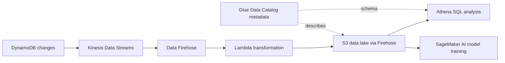

# Cloud Integration

Work through the explanations, examples, and service comparisons below. Use the [reference notes](#reference-notes) for revision, or follow the [exam-task reading path](/study-guide#detailed-reading-by-exam-task) to study in syllabus order.

## Exam task 3.7: AI ML and analytics

### Map pipeline stages to AWS services

| Stage | Service | Core role |
|---|---|---|
| Ingest a real-time event stream | Kinesis Data Streams | Capture a stream for applications/consumers |
| Deliver streaming data to destinations | Amazon Data Firehose | Managed buffered delivery, with supported transformations |
| Store data lake objects | Amazon S3 | Durable object storage for varied data formats |
| Store/analyze warehouse data | Amazon Redshift | Analytical data warehouse and SQL workloads |
| Describe datasets | AWS Glue Data Catalog | Metadata such as schema and location |
| Prepare and transform data | AWS Glue | Managed data integration and ETL jobs |
| Process big data with familiar frameworks | Amazon EMR | Spark, Hadoop, Hive and other supported frameworks |
| Query S3 data using SQL | Amazon Athena | Serverless interactive query |
| Build BI dashboards and reports | QuickSight, called Quick Sight in current Quick docs | Business intelligence and visualization |
| Search and analyze logs/operational data | Amazon OpenSearch Service | Search, log analytics, and observability |

#### Kinesis Data Streams versus Firehose

Kinesis Data Streams exposes an event stream that consumers process. The course emphasizes multiple applications consuming the stream. On-demand and provisioned capacity options affect management; do not assume every configuration scales in the same way.

Firehose focuses on managed delivery into a supported destination. Buffering, transformations, destination behavior, and configuration affect latency. “Near real time” does not mean immediate delivery or a universal fixed number of seconds. It is not automatically a broadcast mechanism that sends one delivery stream to every possible destination.

#### Data lake versus warehouse

S3 is a common foundation for a data lake containing structured, semistructured, and unstructured objects. A usable lake still needs organization, permissions, and metadata. Redshift is optimized for analytics such as aggregating large sales datasets and joining business information. It uses columnar storage and parallel processing; it differs from the operational RDS database serving individual application transactions.

**Exam extension:** Redshift has provisioned and serverless options. “Managed warehouse” does not mean a customer must always size a traditional cluster, nor that every analytics workload must copy all data into Redshift.

#### Catalog versus processing

The Glue Data Catalog stores descriptions of data, not the underlying S3 dataset itself. A table can describe where files live and how to interpret columns. Glue ETL jobs use data and metadata to perform transformations. Cataloging a dataset does not automatically clean it, copy it, or grant access to it.

EMR is the clue for an existing big-data framework workload, especially when the question names Spark or Hadoop and custom configurations. Glue is the clue for managed data integration and ETL. There is overlap;Glue can use Spark;so the word “Spark” alone does not make every transformation an EMR-only task. Operational responsibilities depend on the chosen deployment.

#### Query versus visualization versus search

Athena is the classic answer to “ad hoc SQL directly against files in S3 without managing servers.” It can use Glue Data Catalog definitions. Broader sources require supported integrations, appropriate connectors, configuration, and permissions; “query anywhere” is not unrestricted access to every system. [Athena overview](https://docs.aws.amazon.com/athena/latest/ug/what-is.html).

Redshift fits warehouse-oriented analytical workloads. QuickSight builds dashboards and BI reports over appropriate sources. OpenSearch Service fits search and operational analysis such as finding error patterns in application logs. SQL querying, visualization, and search can coexist in one solution, but solve different immediate needs.

*Adapted study material; [Module 8, section 6 (course background)](https://www.coursera.org/learn/aws-cloud-practitioner-essentials/lecture/Fz1tu/introduction-to-ai-and-machine-learning).*

### Reconstructing the real-life pipeline

The final video uses an e-commerce application with operational customer data in DynamoDB. Both analysts and ML engineers need useful copies for analysis and model updates. This is the course's conceptual design; no AWS resources were deployed while preparing the notes.

1. **Operational source:** DynamoDB supports the app's low-latency item access. Broad recurring table scans are not the chosen analytical ingestion strategy.
2. **Capture changes:** Configure DynamoDB's integration with Kinesis Data Streams. This produces change records; it is distinct from treating a stream as a complete historical table export. The AWS documentation also notes that duplicates and reordered change notifications can occur. [DynamoDB change capture](https://docs.aws.amazon.com/amazondynamodb/latest/developerguide/kds.html).
3. **Managed delivery:** Firehose reads the Kinesis source and handles delivery to S3 with the selected buffering and configuration.
4. **Transform:** Firehose invokes Lambda for the example's JSON-to-CSV conversion. Lambda returns transformed records to Firehose, which delivers the output. This is custom transformation logic, not Firehose's built-in JSON-to-Parquet/ORC format converter. [Firehose format conversion](https://docs.aws.amazon.com/firehose/latest/dev/record-format-conversion.html).
5. **Store:** S3 holds data accessible to multiple downstream consumers. CSV is the example's requested format, not a universal requirement for Athena or ML.
6. **Describe:** A Glue Data Catalog table describes location and schema. It does not relocate all the data into the catalog.
7. **Analyze:** Athena uses SQL against the prepared S3 data and catalog metadata.
8. **Train:** SageMaker AI reads suitable training data from S3 to train new model versions. Capturing new data and retraining a model are separate processes that need scheduling or orchestration.

**Exam extension:** A working production design must address an initial data baseline, updates/deletes, duplicates, schema changes, failure handling, and model evaluation. A continuous change feed alone does not reconstruct all historical data that existed before capture began. Do not interpret the diagram as a complete deployable specification or the only possible integration path.

*Adapted study material; [Module 8, section 7 (course background)](https://www.coursera.org/learn/aws-cloud-practitioner-essentials/lecture/Fz1tu/introduction-to-ai-and-machine-learning).*

Related explanations for this task: [machine learning](/notes/machine_learning#exam-task-37-ai-ml-and-analytics), [databases](/notes/databases#exam-task-37-ai-ml-and-analytics).

## Exam task 3.8: Other service categories

### Queues reduce direct dependencies

In a tightly coupled workflow, an order-taking component directly hands work to a processing component. If the processor cannot accept the request, the sender may have to wait or fail.

A queue introduces a buffer. The producer submits work; a consumer handles it when able. The two components can operate at different rates and can scale independently. The course uses an order board between the cashier and barista.

Loose coupling reduces the spread of failures. It does not make all failures irrelevant: delayed processing, exhausted retention, invalid messages, or failed business steps still require handling. Likewise, a microservices label does not guarantee loosely coupled behavior.

#### Amazon SQS: keep work for consumers

Amazon Simple Queue Service stores messages so consumers can retrieve and process them independently of producers. It is the strongest fit when a question asks for buffering a backlog, asynchronous work, or workers that may temporarily be unavailable.

The basic sequence is send, receive, process, then delete. Receiving a message does not itself establish successful completion of the business task.

**Exam extension:** Standard queues can deliver a message more than once and provide best-effort ordering. Applications should handle duplicates safely. Messages also have retention limits. Do not interpret the course's reliability language as unlimited retention or a guarantee that processing happens exactly once. See [SQS standard queues](https://docs.aws.amazon.com/AWSSimpleQueueService/latest/SQSDeveloperGuide/standard-queues.html).

#### Amazon SNS: publish to subscribers

Amazon Simple Notification Service uses topics and subscriptions. A publisher sends a message to a topic, and SNS delivers it to subscribers such as applications, queues, email, or other supported endpoints.

Choose SNS for fanout: several independent recipients need a notification about the same event. The video's claim that SNS needs a response immediately is an analogy for push delivery, not a requirement for synchronous business processing.

#### EventBridge: route events

The reading also introduces EventBridge. It routes events from sources such as AWS services, custom applications, and integrated software to matching targets. Choose it when a scenario emphasizes event sources, event patterns, and rule-based routing.

**Correction:** The reading implies EventBridge stores every failed delivery until the service returns. Retries have configured limits. A dead-letter queue can retain events that cannot be delivered under the retry policy. Do not assume indefinite automatic replay. See [EventBridge delivery retries](https://docs.aws.amazon.com/eventbridge/latest/userguide/eb-rule-retry-policy.html).

#### Compare the three

| Requirement | Main fit |
|---|---|
| Workers process a backlog when ready | SQS |
| Publish one message to multiple interested subscribers | SNS |
| Match events and route them from multiple sources | EventBridge |

A useful combination is SNS fanout to separate SQS queues: each subscribing application gets its own backlog. Consumers sharing one work queue should not be confused with independent subscribers each needing a copy. See the [SNS-to-SQS fanout pattern](https://docs.aws.amazon.com/sns/latest/dg/sns-sqs-as-subscriber.html).

*Adapted study material; [Module 2, section 10 (course background)](https://www.coursera.org/learn/aws-cloud-practitioner-essentials/lecture/Awlt0/introduction-to-amazon-ec2).*

Related explanations for this task: [deploying](/notes/deploying#exam-task-38-other-service-categories), [other aws services](/notes/other_aws_services#exam-task-38-other-service-categories).

Study source: independently reconstructed course guides and editorial exam-task notes. Course capture: 16 October 2026; task expansion: 20 October 2026. These explanations are not an official AWS publication. Service qualifications retain their stated review dates.
