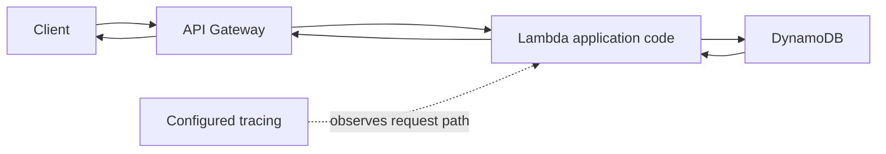

# Other AWS Services

Work through the explanations, examples, and service comparisons below. Use the [reference notes](#reference-notes) for revision, or follow the [exam-task reading path](/study-guide#detailed-reading-by-exam-task) to study in syllabus order.

## Exam task 1.3: Migration strategies and benefits

### Migration is a business and technical change

Cloud migration moves workloads, applications, databases, or other digital assets into a different environment. The source may be an on-premises data center or another cloud. A migration can preserve the existing architecture, introduce selected changes, or redesign the system. Different applications in one portfolio can follow different strategies.

Start with outcomes: why move, what must improve, and what constraints matter? Cost, agility, licensing, resilience, data location, skills, dependencies, and downtime tolerance all affect the plan. Rehosting is not a guaranteed percentage saving, and modernization is not automatically required before every move.

*Adapted study material; [Module 12, section 1 (course background)](https://www.coursera.org/learn/aws-cloud-practitioner-essentials/lecture/BljPn/introduction-to-migration).*

### Three migration phases

| Phase | Purpose | Course tools/examples |
|---|---|---|
| Assess | Understand readiness and develop a business case | Migration Evaluator |
| Mobilize | Close readiness gaps, prepare foundations, plan dependencies and waves | Application Discovery Service, Migration Hub |
| Migrate and modernize | Move, validate, operate, and improve selected workloads | Application Migration Service, DMS, DataSync, Transfer Family, Snow devices |

The phases guide a program, rather than prohibiting discovery after the assess phase. Large migrations are iterative: a pilot can reveal dependencies, which changes later waves. Migration Hub is used across planning and execution; it is not limited to one phase.

**Exam extension:** A migration wave groups workloads for coordinated movement. A cutover switches production use to the target. Testing, acceptance criteria, and a rollback plan are different from merely copying data successfully. Moving an application while leaving its required database or identity provider unreachable can break it even when each server boots.

*Adapted study material; [Module 12, section 2 (course background)](https://www.coursera.org/learn/aws-cloud-practitioner-essentials/lecture/BljPn/introduction-to-migration).*

### AWS Cloud Adoption Framework: six perspectives

AWS CAF organizes transformation guidance around business and technical capabilities. It helps identify gaps and actions across the organization. It is a framework, not a server-copy tool or a product that automatically completes a migration.

| Perspective | Main concern | Typical scenario/roles |
|---|---|---|
| Business | Link cloud investments to outcomes | Business case, finance, strategy, budget owners |
| People | Skills, culture, organizational change | Training, staffing, HR, role changes |
| Governance | Direct investments and manage risk/value | Portfolio priorities, policies, program management |
| Platform | Build the target technology foundation | Architecture, infrastructure, migration patterns |
| Security | Meet security objectives | Identity, protection, visibility, controls |
| Operations | Run and recover workloads effectively | Monitoring, support procedures, service levels |

The course groups Business/People/Governance as business-oriented and Platform/Security/Operations as technology-oriented. This is an organizational aid, not a wall between teams: security and operations still support business goals, and architecture decisions affect cost and risk.

For exam questions, identify the dominant concern. A skills gap is People. Measuring investment value is Business/Governance according to the question's emphasis. Designing the target environment is Platform. Meeting security objectives is Security. Day-to-day workload operation and recovery are Operations. CAF guidance can feed an action plan; it does not guarantee all gaps are closed simply because the plan exists.

*Adapted study material; [Module 12, section 3 (course background)](https://www.coursera.org/learn/aws-cloud-practitioner-essentials/lecture/BljPn/introduction-to-migration).*

### The seven Rs: classify the change

| Strategy | Meaning | Original example |
|---|---|---|
| Rehost | Move with little/no application redesign; lift and shift | Move a server-based application to EC2 |
| Relocate | Move an infrastructure/virtualization environment while preserving its operating model | Shift a compatible virtualized estate at infrastructure level |
| Replatform | Make selected platform optimizations without fundamental architecture redesign | Move a self-managed MySQL database to RDS for MySQL |
| Refactor/re-architect | Redesign to exploit cloud capabilities | Split a monolith into services with event-driven processing |
| Repurchase | Replace the existing product with another offering, commonly SaaS | Replace a self-hosted CRM with a SaaS CRM |
| Retain | Keep the workload in its present environment for now | Delay a system with unresolved constraints |
| Retire | Decommission a workload no longer needed | Remove an unused reporting application after dependency review |

The exam tests the **nature of the change**, not the order of these words. Rehost focuses on moving the workload largely as-is; relocate is more specifically an infrastructure-level move preserving the existing operating approach. The reading's broad “move VMs or containers” definition is insufficient by itself: simply having a VM does not prove relocate rather than rehost. [AWS strategy definitions](https://docs.aws.amazon.com/prescriptive-guidance/latest/large-migration-guide/migration-strategies.html).

Replatform can require compatibility, configuration, integration, or small application changes. The video's “no new development efforts” is an oversimplification; the important distinction is that the core architecture is not fundamentally redesigned. Refactoring usually demands more development effort, but it is not universally the most expensive option in every context.

Repurchase means changing the product/application, not every database engine conversion or license saving. Retain does not mean abandon forever; a workload may be reviewed later. Retire requires checking dependencies and retention needs. A real portfolio often combines all seven strategies, and a workload may be rehosted first and modernized later.

*Adapted study material; [Module 12, section 4 (course background)](https://www.coursera.org/learn/aws-cloud-practitioner-essentials/lecture/BljPn/introduction-to-migration).*

### Planning and application-migration tools

| Tool | Primary role | Common distractor to avoid |
|---|---|---|
| Migration Evaluator | Data-driven migration business case and cost scenarios | It does not itself move all servers |
| Application Discovery Service | Source inventory, usage/configuration, and dependency information | Discovery is not the cutover |
| Migration Hub | Central planning/portfolio visibility and migration tracking | A tracking hub does not replace every transfer engine |
| Application Migration Service, AWS MGN in the course | Server replication, testing, and migration to AWS | Not the same as database schema conversion |

Migration Evaluator helps compare current and target scenarios, including licensing considerations. Its projections depend on data and assumptions; “remove the guesswork” is not a guarantee of an exact future bill. Discovery helps answer what exists and what connects to what. The information collected depends on supported collection methods and configuration, not magic access to every system.

Migration Hub supports visibility across migration activities/tools. A no-additional-charge hub does not make replication infrastructure, storage, data transfer, or every related capability free. [Migration Hub overview](https://docs.aws.amazon.com/migrationhub/latest/ug/whatishub.html).

Application Migration Service focuses on migrating supported physical, virtual, and cloud servers. Its replication approach allows much preparation while the source continues operating. You still need connectivity, supported systems, launch configuration, test validation, and a planned cutover. “Minimal downtime” is not a promise of zero interruption or automatic application correctness.

**Naming update:** Current documentation calls this service **AWS Transform MGN**. Retain the course's Application Migration Service/AWS MGN name when studying its comparisons; the stable role is server migration using replication and test/cutover workflows. [Current MGN overview](https://docs.aws.amazon.com/mgn/latest/ug/what-is-mgn.html).

AWS Migration and Modernization Competency Partners can provide specialized assistance. The toolset supports a migration program, while business decisions, validation, and responsibilities remain with the organization.

*Adapted study material; [Module 12, section 5 (course background)](https://www.coursera.org/learn/aws-cloud-practitioner-essentials/lecture/BljPn/introduction-to-migration).*

### Online data movement: distinguish the layers

#### DataSync: managed data movement

DataSync automates movement between supported storage locations, such as on-premises storage and S3/EFS/FSx destinations where supported. The lesson emphasizes scheduling, bandwidth controls, filtering, validation, and reporting. It fits a bulk storage migration or recurring synchronization job.

It is not automatically an application/database migration engine, and it cannot exceed the physical limits of the network or storage indefinitely. Source/destination support, agent requirements, permissions, transfer mode, and validation configuration matter. A task completing is not by itself proof that an application's entire dependency set was migrated.

#### Transfer Family: preserve file-transfer workflows

Transfer Family provides managed protocol-based file-transfer capabilities with supported AWS storage integrations. The classic scenario is a partner or employee already using SFTP/FTPS/FTP and needing managed access to files backed by S3 or EFS, subject to protocol/endpoint support.

The reading describes all listed protocols as secure. **FTP itself is unencrypted.** SFTP and FTPS provide different encrypted protocol mechanisms; choosing a managed service does not transform plain FTP into encrypted transfer. Configure identity, storage permissions, networking, and protocol deliberately. [Transfer protocol distinctions](https://docs.aws.amazon.com/transfer/latest/userguide/edit-server-config.html).

Choose DataSync when the question emphasizes managed bulk/scheduled storage copying and validation. Choose Transfer Family when it emphasizes existing partner/client file-transfer protocols. They can support related data workflows but answer different immediate requirements.

#### Direct Connect: network connectivity

Direct Connect establishes dedicated private connectivity between the customer's network and AWS. It provides a network path, rather than a complete file-copy, validation, or schema-conversion workflow. DataSync or application transfer tools may use an appropriate connection.

A private path is **not automatically encrypted**. Direct Connect does not encrypt traffic by default; use appropriate application encryption, VPN, or supported MACsec options where required and available. Bandwidth, provisioning time, resilience, and costs also need planning. “Dedicated” does not guarantee that every end-to-end workload transfer is fast, redundant, or cheaper. [Direct Connect encryption](https://docs.aws.amazon.com/directconnect/latest/UserGuide/encryption-in-transit.html).

*Adapted study material; [Module 12, section 7 (course background)](https://www.coursera.org/learn/aws-cloud-practitioner-essentials/lecture/BljPn/introduction-to-migration).*

### Offline movement: Snowball Edge in the course

The offline reading introduces rugged Snowball Edge Storage Optimized devices. Copy data onto a device locally, ship it, and import it into AWS using the supported job workflow. Local compute capabilities can also support selected edge workloads. This is a conceptual answer to moving a large dataset when a usable network path is absent or too constrained.

Physical shipping can be faster than a limited link for very large datasets, but not in every case. Compare ordering/shipping, local copying, validation, import, and ongoing delta-transfer time with the online alternative. Device models, capacities, ordering eligibility, and Regional availability can change; the course name/capability is not a promise that a specific device is currently orderable for every customer. [Snowball Edge concepts](https://docs.aws.amazon.com/snowball/latest/developer-guide/whatisedge.html).

**Exam extension:** An idealized transfer-time estimate is data bits ÷ available bits per second. For example, 100 TB at 100 Mbit/s takes roughly 8 million seconds, or 93 days, before protocol overhead, competing traffic, and downtime. That illustrates why shipping might matter. Actual measurements and end-to-end logistics determine the better route.

A device holding the initial dataset does not capture every subsequent source change while it is in transit. Plan any needed incremental synchronization and final cutover. Protect encryption keys, access, chain of custody, and validation throughout the move.

*Adapted study material; [Module 12, section 8 (course background)](https://www.coursera.org/learn/aws-cloud-practitioner-essentials/lecture/BljPn/introduction-to-migration).*

### Reconstructing a migration decision

The module has explanatory examples rather than a hands-on deployment. No servers, database tasks, connectivity, or shipment orders were created for this pack.

1. **Assess:** A retailer inventories its systems and uses projected cost/business outcomes to decide what is worth moving.
2. **Mobilize:** It identifies the web app's database, identity, DNS, and file dependencies, prepares accounts/networking/security, and builds pilot waves.
3. **Select strategies:** An unused report is retired; a constrained system is retained; a server app is rehosted; its self-managed database is replatformed to an appropriate managed service; an old CRM is replaced with SaaS.
4. **Select movement tools:** MGN replicates the supported servers; DMS handles supported database data/change replication, with schema conversion if needed; DataSync handles suitable file storage.
5. **Validate:** Teams test application behavior, permissions, performance, recovery, data completeness, and operations.
6. **Cut over and improve:** Teams coordinate the production switch, monitor results, retain a workable fallback strategy, and later optimize or refactor where justified.

The method is more useful than assuming one tool moves every component or that one R must apply to the whole enterprise.

*Adapted study material; [Module 12, section 9 (course background)](https://www.coursera.org/learn/aws-cloud-practitioner-essentials/lecture/BljPn/introduction-to-migration).*

### Further distinctions

#### CAF capability for business outcomes

Benefits management is a Governance capability: identify desired benefits, choose measures, and track whether cloud investments deliver them. The general word business does not make every outcome-tracking question the Business perspective.

#### CAF operations capability

Performance and capacity management belongs to the Operations perspective. It measures service performance and plans capacity so workloads meet agreed business needs. Benefits management tracks business value under Governance.

### Exam requirements and service choices

#### Separate adoption outcomes from migration mechanisms

AWS CAF describes organizational transformation as well as technology work. Reduced business risk can come from stronger resilience and security; operational efficiency from automation and managed services; increased revenue from faster product delivery; and improved environmental, social, and governance outcomes from more efficient and better governed operations. These are possible business outcomes to assess, not guaranteed results of moving servers.

| Migration question | Relevant resource | Why it fits |
|---|---|---|
| What does the existing estate contain, and what depends on what? | AWS Application Discovery Service | Inventory and utilization/dependency information inform the plan |
| What could the financial business case look like? | Migration Evaluator | Evaluates the existing environment and migration cost scenarios |
| Where can migration progress be tracked? | AWS Migration Hub | Central migration visibility rather than the engine that moves every workload |
| Move a server with minimal application change | AWS Application Migration Service | Server replication, test launches, and migration support rehosting |
| Move database records with limited downtime | AWS DMS | Initial data movement and supported ongoing change replication |
| Change between incompatible database engines | AWS SCT or supported DMS schema conversion, plus DMS | Schema conversion and data replication address different parts of the migration |
| Move file/object datasets over a network | AWS DataSync | Managed transfer is different from provisioning a network connection |
| Retain established SFTP/FTPS/FTP workflows | AWS Transfer Family | Managed file-transfer endpoints support existing workflows |

The last two services are useful related context from the course; they are not substitutes for the database migration tools named in the task requirements. Service-list membership and service availability can change, so distinguish core named exam services from additional course examples.

**Worked choice:** A business wants its Oracle database moved to a different compatible target engine with a short cutover window. First assess schema and code compatibility; convert supported structures where needed; copy the initial data; replicate supported ongoing changes; validate; then cut over. DMS alone does not guarantee that every stored procedure or vendor-specific feature is converted. If the source and target use the same engine, the migration can be homogeneous and schema conversion may not be needed.

**Check yourself:** Is changing only the hosting location refactoring? No; a minimal-change server move is typically rehosting. Is replacing a self-hosted product with SaaS replatforming? The better strategy label is repurchasing. Can CAF People issues be solved solely by replicating servers? No; skills, roles, and organizational change require people-focused work.

Sources: [AWS CAF overview](https://docs.aws.amazon.com/whitepapers/latest/overview-aws-cloud-adoption-framework/welcome.html), [DMS overview](https://docs.aws.amazon.com/dms/latest/userguide/Welcome.html), and [AWS SCT](https://docs.aws.amazon.com/SchemaConversionTool/latest/userguide/CHAP_Welcome.html).

### Before continuing

Explain Assess, Mobilize, Migrate and modernize; all seven Rs; CAF Business, People, Governance, Platform, Security, and Operations. Match Evaluator to business case, Discovery to inventory, MGN to servers, DMS to database movement.

Explain the main concepts aloud and compare the services with similar purposes. Return to the relevant section whenever you cannot justify the distinction.

## Exam task 3.6: Storage services

### Storage Gateway: preserve local interfaces

Storage Gateway connects on-premises storage workflows with AWS storage. The local interface is often the deciding clue:

| Type | Interface or workflow | Data arrangement emphasized |
|---|---|---|
| S3 File Gateway | Familiar file access | Files backed by S3 objects with local caching |
| Volume Gateway, cached | iSCSI volumes | Primary data in AWS, frequently used data cached locally |
| Volume Gateway, stored | iSCSI volumes | Full dataset local, asynchronously backed up as EBS snapshots |
| Tape Gateway | Existing tape backup software | Virtual tapes instead of physical tape infrastructure |

The gateway bridges storage, not every network or application requirement. It still needs deployment, connectivity, cache/configuration choices, and backup/retention planning. The phrase “everything is seamlessly backed up” should not replace a verified protection policy.

*Adapted study material; [Module 6, section 12 (course background)](https://www.coursera.org/learn/aws-cloud-practitioner-essentials/lecture/6Bz4a/introduction-to-storage).*

### Elastic Disaster Recovery

AWS Elastic Disaster Recovery replicates supported servers' block-level data to AWS and supports launching recovery instances and testing recovery. This addresses workload recovery rather than merely storing a file or offering a shared filesystem.

**Correction:** The reading claims there are no standby infrastructure costs. AWS uses a staging area with storage and minimal compute to maintain replication, so reduced standby cost is not zero cost. Replication health, launch settings, drills, and failback planning remain important. See [Elastic Disaster Recovery](https://docs.aws.amazon.com/drs/latest/userguide/what-is-drs.html).

Backup, replication, availability, and disaster recovery overlap but are not identical. A snapshot can restore a volume; recovering a business application also requires working compute, networking, configuration, and data consistency.

*Adapted study material; [Module 6, section 13 (course background)](https://www.coursera.org/learn/aws-cloud-practitioner-essentials/lecture/6Bz4a/introduction-to-storage).*

Related explanations for this task: [ec2 storage](/notes/ec2_storage#exam-task-36-storage-services), [s3](/notes/s3#exam-task-36-storage-services).

## Exam task 3.8: Other service categories

### Business, end-user computing, and device services

| Scenario clue | Course service |
|---|---|
| Contact center, routing, agents, callbacks, customer conversations | Amazon Connect |
| Transactional or marketing email from an application | Amazon Simple Email Service, SES |
| Stream desktop applications without local installation | Amazon AppStream 2.0 |
| Provide a cloud desktop/work environment | Amazon WorkSpaces |
| Remote enterprise browser for websites/SaaS | WorkSpaces Secure Browser |
| Connect physical devices to cloud applications | AWS IoT Core |

Connect supports contact-center flows and agent interactions. SES provides programmatic email sending; it is not a general replacement for every employee mailbox product. Sender verification, permissions, quotas, deliverability, and abuse controls matter. Neither a diagram nor a successful API call guarantees every message reaches an inbox.

For end-user computing, ask what must be delivered: an **application**, a **desktop**, or a **browser session**. These services can overlap in capability, but the stated need supplies the exam clue. The course's “any device” means supported compatible clients/browsers and connectivity, not literal compatibility with every device or license.

**Naming note:** Current documentation calls AppStream 2.0 **Amazon WorkSpaces Applications**. The reading already updates WorkSpaces Web to **WorkSpaces Secure Browser**, while the transcript uses the older Web name. Preserve these mappings for service recognition rather than memorizing only one historical brand. [Application-streaming documentation](https://docs.aws.amazon.com/appstream2/latest/developerguide/what-is-appstream.html).

IoT Core supports device connectivity and messaging with authentication, policies, and encrypted transport for supported protocols. Examples include soil sensors, cameras, or remotely managed feeders. The device must be provisioned and authorized appropriately. A secure device-to-service connection does not mean every message is encrypted end-to-end through all downstream consumers, or that every protocol uses identical authentication. [IoT protocol/security options](https://docs.aws.amazon.com/iot/latest/developerguide/protocols.html).

*Adapted study material; [Module 13, section 5 (course background)](https://www.coursera.org/learn/aws-cloud-practitioner-essentials/lecture/T6DZG/introduction-to-well-architected-solutions).*

### Reconstructing the serverless examples

The final lessons contain conceptual architecture diagrams. No applications, email messages, contact centers, or AWS resources were deployed while preparing this pack.

#### Example A: API-backed application

API Gateway exposes an HTTP API, Lambda executes application logic, and DynamoDB stores/retrieves data. Appropriate tracing helps diagnose calls through supported components. Authentication, authorization, request validation, throttling, backend permissions, and error handling are configuration/application concerns. API Gateway does not automatically validate every business rule just because it receives a request.

“Serverless” means the customer does not provision/manage the underlying servers for these components. Servers still exist, quotas and limits still apply, and the customer still owns code, permissions, data modeling, and operational choices. A managed architecture can scale appropriately without being limitless or free.

#### Example B: static website with a contact form

The static content is hosted using S3 in the course. When the browser submits the form, it calls API Gateway; API Gateway invokes Lambda; Lambda calls SES to send the email. S3 serves files;it does not execute the form's server-side business logic or send the email by itself.

**Exam extension:** S3 website endpoints do not support HTTPS directly. Appropriate Amplify Hosting or CloudFront designs can provide HTTPS delivery. A private S3 REST-origin design differs from using a public S3 website endpoint. The video's “drag, drop, enable” summary omits access, hosting, certificate, and application configuration. [S3 website endpoint behavior](https://docs.aws.amazon.com/AmazonS3/latest/userguide/WebsiteEndpoints.html).

Keep AWS credentials out of browser code. Give the backend only necessary permissions, validate and rate-limit submissions as appropriate, and plan for duplicate requests or send failures. These are implementation implications, not actions performed in this collection task.

#### Example C: contact center with callback/channel options

Connect handles the customer interaction and agent/contact flow. A customer waiting in a queue can be offered a configured callback or an alternate supported channel. Lambda can integrate business logic where the flow requires it.

The reading says text messages are routed from CloudFront. CloudFront distributes web content and may deliver a web interface; it is not an SMS routing service or the core chat transport. A website can embed a Connect communications widget or use appropriate APIs. Actual SMS and channel transitions need their supported messaging integrations and contact flows. Do not memorize “CloudFront routes text messages” as a service capability. [Connect website chat integration](https://docs.aws.amazon.com/connect/latest/adminguide/add-chat-to-website.html).

Callbacks also require configured flows and agent capacity; they are not a guarantee of immediate human availability. The useful exam lesson is how contact-center services and serverless integrations combine to address a customer-service requirement.

*Adapted study material; [Module 13, section 6 (course background)](https://www.coursera.org/learn/aws-cloud-practitioner-essentials/lecture/T6DZG/introduction-to-well-architected-solutions).*

### Further distinctions

#### Queue messages in FIFO order

Amazon SQS FIFO queues provide ordered message handling within message groups and deduplication capabilities. Consumers should still handle retries safely. SNS can also have FIFO topics; the decisive requirement here is a queue that stores messages for workers to receive.

### Exam requirements and service choices

#### Add workflow orchestration to messaging

**AWS Step Functions** coordinates application steps using state machines. A workflow can call supported services, branch on results, run steps in parallel, wait, and apply configured retry/error handling. Lambda can execute a step's code; Step Functions coordinates the sequence and state. It is therefore relevant when a question asks for a multi-step business process with explicit order and decisions.

| Requirement | Service | Why it fits |
|---|---|---|
| Buffer work until consumers are ready | Amazon SQS | A queue decouples producers and workers |
| Send the same notification to independent subscribers | Amazon SNS | Publish/subscribe and fanout |
| Route matching events from sources to targets | Amazon EventBridge | Event patterns and routing integrations |
| Coordinate a multi-step business workflow | AWS Step Functions | State, sequence, branching, retries, and supported integrations |
| Compile code and run build tests | AWS CodeBuild | Performs build jobs |
| Coordinate source/build/test/deploy release stages | AWS CodePipeline | Delivery workflow rather than a general customer-order state machine |
| Trace a request through distributed services | AWS X-Ray | Trace timing/errors rather than queue storage or API audit history |

**Worked choice:** An order must validate payment, wait for approval, reserve inventory, and notify the customer, with different paths for failure. Step Functions coordinates the process. An incoming event could start it through EventBridge; Lambda can perform custom steps; SNS can send a notification; and SQS can buffer fulfillment work. These services complement one another. A queue alone does not define the whole approval workflow.

#### Match business and end-user services to the actual output

**Amazon Connect** supplies contact-center capabilities. **Amazon SES** sends application email rather than furnishing a complete employee desktop/mailbox. **Amazon WorkSpaces** supplies cloud desktop environments. **Amazon AppStream 2.0**, now documented as **WorkSpaces Applications**, streams applications. **WorkSpaces Secure Browser** supplies managed remote browser access. A requirement for a full desktop is different from one application or one browser session.

**AWS Amplify** supports frontend/full-stack web and mobile development and hosting capabilities. **API Gateway** exposes managed application APIs. **AWS IoT Core** connects/authenticates devices and supports messaging/routing to cloud applications; it is not the device's physical sensor or a replacement for every downstream analytics service.

Customer enablement also belongs in this task: **AWS Support** provides assistance under the selected plan; **AWS Professional Services** provides consulting/implementation engagements; and **AWS Partners** can supply specialist solutions or operational services. Use Task 4.3 for the plan/resource comparison when the requirement concerns help rather than application functionality.

**Check yourself:** Need a release pipeline or an order state machine? CodePipeline or Step Functions respectively. Need a web frontend or a virtual Windows application stream? Amplify or AppStream/WorkSpaces Applications. The output requirement decides the category.

Sources: [Step Functions](https://docs.aws.amazon.com/step-functions/latest/dg/welcome.html), [CodePipeline](https://docs.aws.amazon.com/codepipeline/latest/userguide/welcome.html), [AppStream naming](https://docs.aws.amazon.com/appstream2/latest/developerguide/what-is-appstream.html), and [IoT Core](https://docs.aws.amazon.com/iot/latest/developerguide/what-is-aws-iot.html).

### Before continuing

Explain SNS fanout, EventBridge event routing, Step Functions orchestration, Connect contact centers, SES email, CodeBuild, CodePipeline, X-Ray, WorkSpaces, AppStream/WorkSpaces Applications, Amplify, and IoT Core.

Explain the main concepts aloud and compare the services with similar purposes. Return to the relevant section whenever you cannot justify the distinction.

Related explanations for this task: [cloud integration](/notes/cloud_integration#exam-task-38-other-service-categories), [deploying](/notes/deploying#exam-task-38-other-service-categories).

Study source: independently reconstructed course guides and editorial exam-task notes. Course capture: 16 October 2026; task expansion: 20 October 2026. These explanations are not an official AWS publication. Service qualifications retain their stated review dates.
